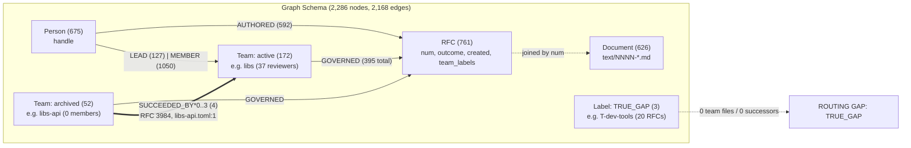
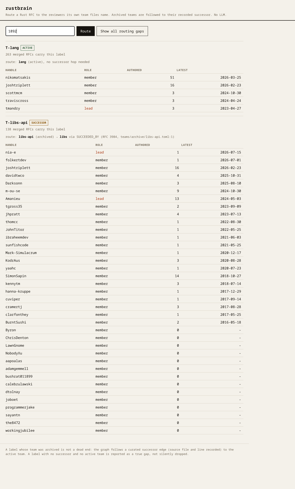
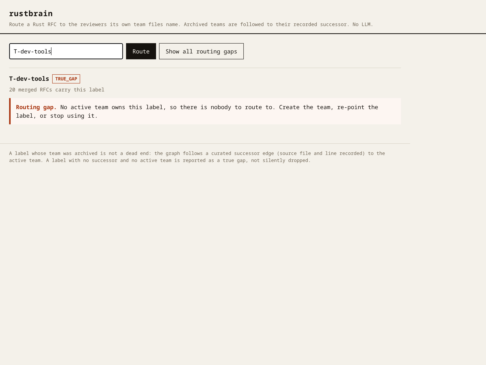
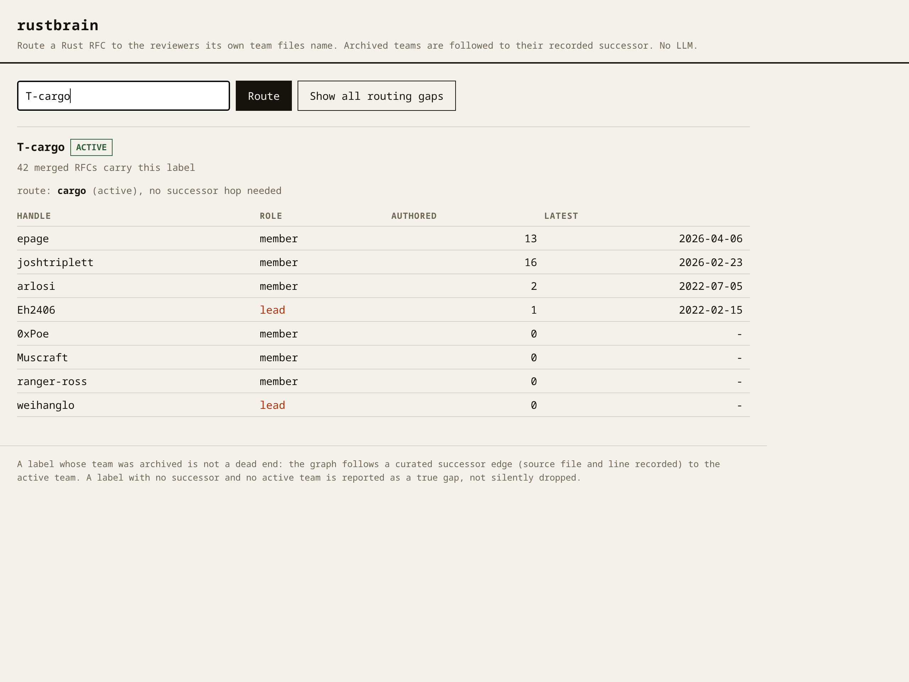

# rustbrain

**Track 03: Company Brain.** `rustbrain` routes a Rust RFC to the active reviewers listed in the Rust project's published team files. When a label points to an archived team, the graph follows a verified `SUCCEEDED_BY` edge to the active successor team; when a label has no successor, it reports a true routing gap instead of returning an empty table. Zero LLMs, zero network in CI.

**live: [langersword.github.io/rustbrain](https://langersword.github.io/rustbrain/)** (if you like it, a ⭐ helps the next person find it) | [](https://github.com/LangerSword/rustbrain/actions/runs/39195941817)

## How the graph works



- **Nodes:** `Team` (224: 172 active, 52 archived), `Person` (675 handles), `RFC` (761 merged PRs without `not-rfc`), `Document` (626 paths).
- **Directed edges:** `(Person)-[:MEMBER]->(Team)` (1,050), `(Person)-[:LEAD]->(Team)` (127), `(Person)-[:AUTHORED]->(RFC)` (592), `(Team)-[:GOVERNED]->(RFC)` (395), `(Team)-[:SUCCEEDED_BY]->(Team)` (4).

```cypher
// queries/routing.cypher — 0 hops for active teams, 1..3 hops for archived teams
MATCH (labelled:Team {slug: $slug})
MATCH (labelled)-[:SUCCEEDED_BY*0..3]->(owner:Team)
WHERE owner.status = 'active'
MATCH (owner)<-[r:LEAD|MEMBER]-(p:Person)
OPTIONAL MATCH (p)-[:AUTHORED]->(authored:RFC)
WITH owner, p, collect(DISTINCT type(r)) AS kinds,
     count(DISTINCT authored) AS authored_count, max(authored.created) AS latest
RETURN owner.slug AS owner, p.handle AS handle,
       CASE WHEN 'LEAD' IN kinds THEN 'lead' ELSE 'member' END AS role,
       authored_count AS authored, coalesce(latest, '') AS latest
ORDER BY latest DESC, authored DESC, handle
```

Four design decisions carry the system:

1. **Variable-depth traversal (`SUCCEEDED_BY*0..3`).** `T-libs-api` (138 RFCs) and `T-core` (24 RFCs) point to archived teams with 0 members. One query routes both active teams (`0` hops) and archived teams (`1` hop via `data/successors.yaml`), rescuing **162 of 761 merged RFCs** from a dead end (`out/blog_evidence/successor_audit.md`).
2. **Recency-first sorting (`ORDER BY latest DESC`).** Sorting by volume alone routes work to retired maintainers (`alexcrichton` has 42 RFCs, last active `2018-02-07`). Sorting by latest RFC date puts current maintainers first (`out/blog_evidence/routing_examples.md`).
3. **Direction-flip CI assertions.** In Cypher, a reversed arrow returns 0 rows without error. `scripts/test_queries.py` runs 41 assertions, verifying every query forward (`> 0` rows) and flipped (`== 0` rows) (`out/blog_evidence/direction_receipt.txt`).
4. **Dual-parser & corruption checks.** `scripts/build_snapshot.py --check` verifies the on-disk SHA-256 (`6732467a070a...`) and byte-identical rebuild; `scripts/verify_snapshot.py` checks all 224 teams against Python's `tomllib` (`out/blog_evidence/01_snapshot_bugs.md`).

## Gallery

| Tier 2: Successor hop (`RFC 1892`) | Tier 3: True gap (`T-dev-tools`) | Tier 1: Active (`T-cargo`) |
|---|---|---|
|  |  |  |
| `libs-api` (0 members) -> `libs` (37 reviewers) | 20 merged RFCs, no team file anywhere | 42 merged RFCs, 0 hops needed |

## The revamp: the scroll is the story of one RFC

The home page now walks one RFC's route as six scenes with a scene rail: arrival (RFC 1892, masked line reveals), the dead end (the roster empties to zero, the naive lookup line), the hop (the `SUCCEEDED_BY` edge draws itself with DrawSVG, the recorded quote lands, reviewers stagger in), the gap (`T-dev-tools`, a line that stops), the numbers (counters to the `site/data.json` values, three tiers on one bar denominator), and the close. Motion explains the product; nothing else moves.

- Native scroll only: keyboard, anchors, back button, reload restore and 200 percent zoom all verified. No scroll hijacking, no zoom block.
- Reduced motion gets the static final states (`gsap.matchMedia`); no pins, no scrub.
- The no-JS HTML carries the full story and every final number; `scripts/assert_site_numbers.py` re-derives the counters, every SVG label and the tier bars from the snapshot in CI.
- Measured: 0.28 percent of frames over 25 ms during a scripted scroll at 1440 (0.13 percent at 390), zero console errors, 61 KB gzip of JS total, worst long task 296 ms at boot. Receipts: `out/revamp/30_VERIFY.md` and `out/blog_evidence/21_revamp.md`; captures at three widths in `out/revamp/review/`.

## Run it (verified from a clean clone)

```bash
git clone https://github.com/LangerSword/rustbrain && cd rustbrain
python3 -c "import yaml" || pip install pyyaml

# 1. Verify deterministic snapshot and independent tomllib parser (offline)
python3 scripts/build_snapshot.py --check
python3 scripts/verify_snapshot.py

# 2. Start FalkorDB ver 42201 (Option A: Docker | Option B: rootless extractor)
docker run -d -p 6379:6379 falkordb/falkordb@sha256:b0bdcac2cbaff989e77cb0610439b7a9289e86de033ccbbd4368b66fb680ae7a
# No Docker? Run: python3 scripts/extract_module.py && scripts/start_module.sh 6379

# 3. Load graph, run 41 query assertions, route RFC #1892, and start UI
export FALKORDB_PORT=6379
python3 scripts/load_graph.py
python3 scripts/test_queries.py
python3 cmd/route.py 1892              # --naive shows the 0-member dead end
python3 cmd/gaps.py                    # 3-tier gap report across all 19 T-* labels
python3 cmd/refresh.py --bump          # re-fetch upstream HEAD and write diff report
python3 cmd/serve.py                   # local UI at http://127.0.0.1:8788
```

## Coverage, 8-element score, and limits

Scoped to `rust-lang/rfcs` (`d2705ad64ba47`, 761 merged PRs without `not-rfc`) and `rust-lang/team` (`a5176049c11ca0`, 224 team files). Asserted in CI by `scripts/verify_readme_numbers.py`:

| measure | value | num / den | note |
|---|---|---|---|
| Labels -> active team / any team file | 73.7% / 89.5% | 14/19 / 17/19 | 2 labels (`T-dev-tools`, `T-doc`) have no file |
| RFCs routable (0 hops / with successor hop) | 46.9% / 63.9% | 357/761 / 486/761 | 162 RFCs resolve only via `SUCCEEDED_BY` |
| RFCs with no `T-*` label | 34.2% | 260 / 761 | Unroutable by team label |
| Numbered RFC files joining to merged RFC | 96.0% | 626 / 652 | `data/rfcs_text_index.json` |
| Authors on active team (RFCs / all PRs) | 35.1% / 26.3% | 85/242 / 100/380 | 381/761 RFCs (50.1%) have no active-team author |
| RFCs with no team & no alumni (all / `merge`) | 22.2% / 5.4% | 169/761 / 41/761 | Corrected definitions (`20_orphan_figure_correction.md`) |

- **8-element brief score: 7 / 8.** People (675), Teams (224), Projects (337 `repos/` TOMLs: `write` 206, `maintain` 127, `triage` 15 across 107 teams), Documents (626), Decisions (761: 241 `merge`, 520 `none`), Stays current (`refresh.py --bump` caught `joboet` leaving `libs-ping`), Agent workflow (`cmd/route.py` + `reports/`). **Element 8 (company-like setting) is 0 by nature:** Rust is a foundation project with peer team leads and zero revenue, customer, salary, or reporting-line data (`out/blog_evidence/company_like_0.md`).
- **Curated successor map & engine calibrations:** `data/successors.yaml` maps the 4 of 52 archived files that cite a successor on disk (3 unmapped, 45 without notes). Calibrated for FalkorDB `ver 42201` (v4.22.1): uses `collect(DISTINCT type(r))` (pattern in `CASE` is always truthy) and `coalesce(latest, '')` (`ORDER BY max() DESC` sorts `NULL` first).
- **Privacy & AI disclosure:** Handles only; zero names, emails, or RFC bodies (`titles` capped at 120 chars). Contact fields were stripped via `scripts/sanitize_contact_fields.py` and purged from git history (`out/blog_evidence/email_removal_receipt.md`). Code written with Hermes Agent (Nous Research) under the entrant's direction; all counts are script-verified in CI.

## Stack and layout

| path / dependency | role |
|---|---|
| `cmd/{route,gaps,refresh,serve}.py` | CLI commands and local HTTP server (`Python 3.12+`, `PyYAML 6.0+`) |
| `queries/*.cypher` | Pinned Cypher queries with documented edge directions (`FalkorDB v4.22.1`) |
| `scripts/*.py` | Offline snapshot builder, `tomllib` verifier, RESP loader, and 41 CI assertions |
| `data/` & `PINS.md` | Hashed `snapshot.json`, curated `successors.yaml`, sanitized `upstream/team/` |
| `site/` & `docs/` | Static web UI ([live](https://langersword.github.io/rustbrain/)), `DEMO.md`, `HASHNODE_BLOG.md`, `SUBMISSION.md` |

Unofficial governance tool built on public `rust-lang` metadata (MIT / Apache-2.0). If it helped you, please ⭐ **[LangerSword/rustbrain](https://github.com/LangerSword/rustbrain)**.
